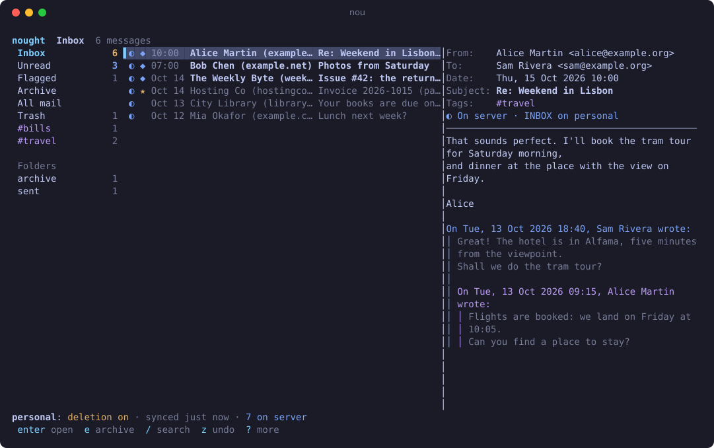
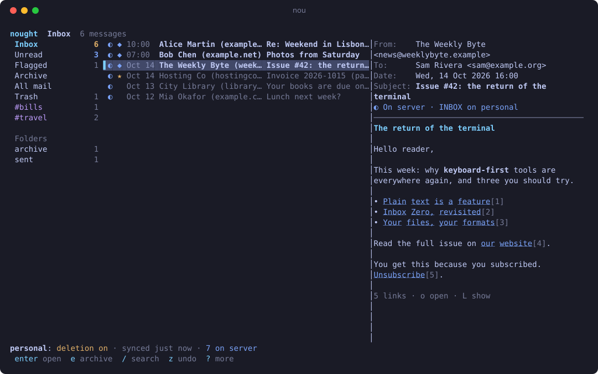
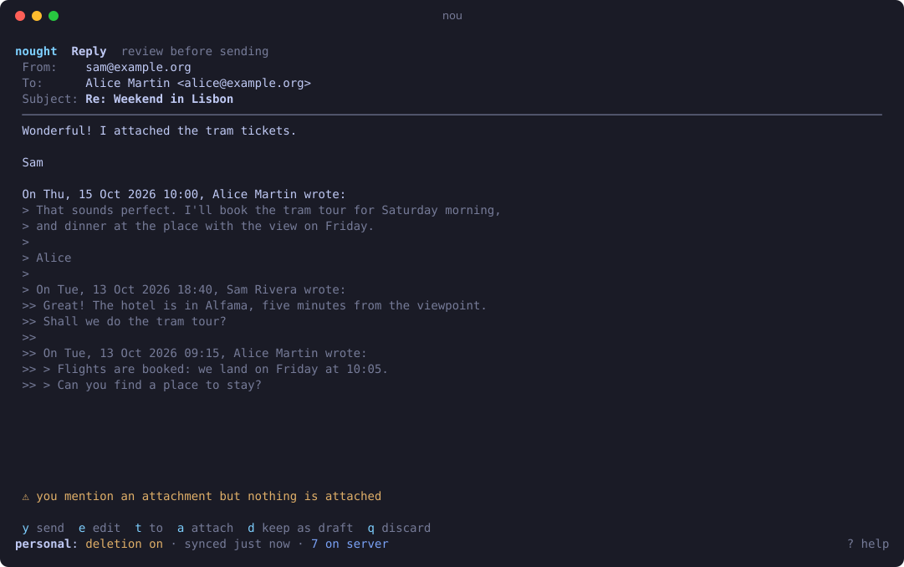
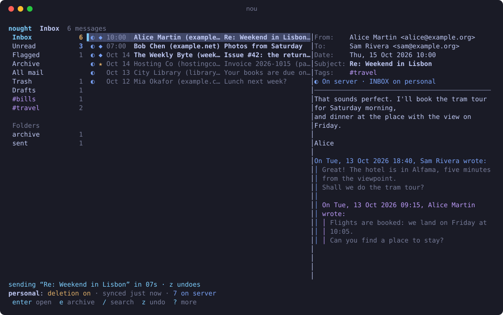
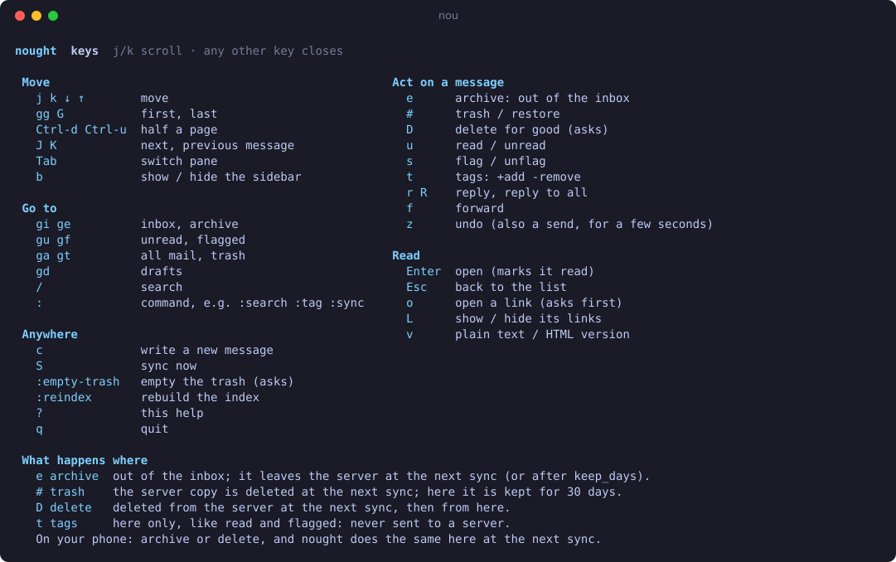

# nought

**nought** (command: `nou`) is a privacy-first **Inbox Zero** mail client you can drive entirely
from the command line.

It archives your mail locally, in plain files you own, and keeps the server down to your inbox.
Everything it does is a command with `--json` output and stable exit codes, so shell scripts, cron
jobs and AI agents can use it as easily as you can. There is also a keyboard-driven TUI.

The idea comes from マリウス's
[Inbox Zero for Privacy, not Productivity](https://xn--gckvb8fzb.com/inbox-zero-for-privacy-not-productivity):
once you have dealt with a message, it leaves the server for storage you control, so a breach of
your mail provider exposes as little as possible.


> **Status:** early development. Import, archive, search, tags, sync with verified server deletion,
> mirroring of what your phone does, writing and sending mail, and the TUI work. MCP, PGP and a GUI
> are planned.

## A quick tour

**Always know where a message lives:** on the server, leaving it soon, or only in your archive.
Quotes are colored by level, so a long thread stays easy to follow.



**HTML mail, read as text.** Nothing is rendered or fetched: no tracking pixels, no remote
images. Links become numbered references, and `o` opens one after showing where it goes.



**Write in your own editor, then review.** nought checks the message before it goes: missing
recipients, a sender that is not yours, an attachment you mention but forgot, a typo in an address.



**Undo send.** A sent message waits a few seconds, counting down; `z` brings it back.



**Every key on one page** (`?`):



The screenshots and the demo show a made-up mailbox: `make screenshots` draws them from the real
TUI, and `make demo` records the demo against the local test environment.

## Principles

- **Never lose mail.** A message is deleted from the server only after its local copy has been
  written, fsynced, read back and hash-verified, and only when you have enabled deletion for that
  account. Every deletion is journaled first.
- **Privacy by default.** No telemetry, no update checks, no remote content. HTML mail is never
  rendered: it is converted to text, and text hidden from view (preheaders, invisible blocks) is
  dropped. When a message has both versions, the converted HTML is shown; `v` in the TUI, or
  `nou msg show --prefer plain`, shows the sender's plain text, and `prefer_body = "plain"` in
  the config makes that the default.
- **No lock-in.** Mail is stored as one `.eml` file per message in a standard Maildir; tags are
  dumped in notmuch's format. neomutt, notmuch, grep, restic and rclone all work on it.
- **Simple and auditable.** Go, a single static binary, few dependencies.

## Install

Download the archive for your system from the
[releases](https://github.com/pluja/nought/releases) (Linux, macOS, Windows and FreeBSD, on
amd64 and arm64), unpack it, and put `nou` on your `PATH`. It is a single file with no
dependencies.

Check that the download is the one GitHub built from this repository, and that it is intact:

```sh
gh attestation verify nou_v0.1.0_linux_amd64.tar.gz --repo pluja/nought
sha256sum --check --ignore-missing SHA256SUMS
```

Builds are reproducible: `make dist VERSION=v0.1.0` on the tagged commit gives the same files.

Or build it yourself:

```sh
go install github.com/pluja/nought/cmd/nou@latest   # Go 1.26+, no cgo needed
go build -trimpath -o nou ./cmd/nou                 # from a clone
```

## Quick start

```sh
# 1. Bring in existing mail, e.g. a Thunderbird Maildir/mbox export (safe: read-only on the source).
nou import ~/thunderbird-export --account personal --dry-run
nou import ~/thunderbird-export --account personal

# 2. Add your IMAP account: a wizard finds the server settings from your address
#    (offline first; online only if you agree), tests them and saves.
#    The password goes to the OS keyring (or use a password command).
nou account add
nou account test personal       # shows what sync will do with each server folder

# 3. Archive your mail. Deletion is off until you turn it on.
nou sync

# 4. Triage.
nou search tag:inbox
nou msg show a3f9c2e1b0d4
nou msg tag from:newsletter@example.org --add newsletter --remove inbox
nou msg archive tag:inbox date:..2026-09-30

# 5. When the archive looks right, let nou keep the server down to your inbox.
nou account set personal --deletion enabled
nou sync --dry-run && nou sync
```

**The server's inbox is your inbox.** Mail stays on the server until you deal with it. Once you
archive or delete it, here or on another device, it leaves the server at the next sync (with
deletion enabled; it is always archived first). Mail in other folders (Sent, Archive...) counts as
dealt with once it is archived. Drafts, templates, junk, spam and trash are never archived: the
folders your server marks as such (whatever their name in its language), and folders named like
them; so is Gmail's All Mail, which holds your inbox too.

Each account's folder rules are in the config file; `nou account show <name>` lists them:

```toml
[[account.folder]]
match     = "INBOX"
keep_days = 0     # once dealt with, at least this many days on the server (default 0)
max_days  = 90    # optional: off the server after this, even if not dealt with

[[account.folder]]
match     = "Sent*"
keep_days = 7     # keep a week of sent mail visible on your phone
```

## Using a phone too

Keep any mail app on your phone (Thunderbird, FairEmail, ...) on the same account. It shows your
inbox: what is still to be dealt with. Both sides agree after each sync:

| You do this | on the phone, nought does | in nought, the phone sees |
|---|---|---|
| archive | takes it out of the inbox | it leaves the server's INBOX |
| delete | moves it to the nought trash (`trash_days`, at least 7 days) | it is gone |
| move it back to INBOX | puts it back in the inbox | – |

Read, flagged and tags stay local. Older mail lives in nought, not on the phone: save what you will
need on the go (a ticket, a boarding pass), or leave it in the inbox, or keep a folder on the
server with its own `keep_days` (say, `match = "Travel"` with `keep_days = 30`) and file it there.
Moving mail into an ignored folder (Junk, Drafts...) counts as deleting it. If many messages vanish from a folder at once, nought
assumes a server problem, changes nothing, and asks you to confirm with
`nou sync --accept-removals` (`:sync accept-removals` in the TUI).

The TUI (`nou tui`) syncs when it starts and then every 10 minutes, quietly unless something
changed. After a failure (say, you are offline) it waits twice as long each time, up to an hour.
Set the interval with `sync_every = "30m"` under `[tui]`, or turn it off with `"0"`; `S` syncs
at any time.

## Writing mail

You write in your own editor (`$VISUAL`, then `$EDITOR`, else `vi`). A graphical editor needs its
wait flag (`EDITOR="code --wait"`), or nou takes the message as abandoned. Mail is plain text,
sent over TLS only, with no `User-Agent` or other fingerprint.

In the TUI, `r` replies, `R` replies to all, `f` forwards (with the attachments) and `c` starts a
new message. Your editor opens on a file like this:

```
From: me@example.org
To: Alice <alice@example.org>
Cc:
Bcc:
Subject: Re: Lunch on Friday?
Attach: ~/menu.pdf, ~/map.png
# Lines starting with # are removed. Save and quit to review; quit without saving to cancel.

Sounds good!

On Wed, 14 Oct 2026 09:00, Alice wrote:
> Pizza at noon?
```

When it closes, a review screen shows the message and its checks, then waits for a key: `y` to
send, `e` to edit again, `t` to change To (with completion from people you write to), `a` to
attach a file, `d` to keep it as a draft, or `q` to discard it. Missing recipients, an unknown
sender address, an unreadable attachment or a message over 25 MB stop the send. Other checks only
warn: an empty subject, a mentioned but missing attachment, a reply to all with many recipients,
or an address a letter or two away from someone you know.

**Undo send:** after `y`, the message waits 10 seconds (`send_delay`); `z` brings it back.
Quitting the TUI sends what is still waiting. If the server cannot take a message now (you are
offline), it stays in the outbox and is tried again every few minutes and at each sync. If the
server refuses it, it waits in Drafts (`gd`) with the reason.

From scripts, the message is given in flags and sent at once:

```sh
nou compose --to alice@example.org --subject "Tomorrow" --body-file note.txt --attach menu.pdf --send
echo "Thanks!" | nou msg reply a3f9c2e1b0d4 --body-file - --send
nou msg forward a3f9c2e1b0d4 --to bob@example.org --cc carol@example.org --attach notes.pdf --send
nou compose --to bob@example.org --subject Later --body-file note.txt   # a draft, not sent
nou draft list; nou draft edit <id>; nou draft send <id>
nou outbox list; nou outbox retry <id>; nou outbox cancel <id>
```

`--send` exits with 3 when the message will be retried later, and 1 when the server refused it.

Sent mail is archived, read and out of the inbox, and the message you answered is tagged
`replied`. Settings, per account unless noted:

```toml
send_delay = "10s"      # the TUI's undo window (global; "0" sends at once, at most "5m")

[[account]]
name       = "personal"
email      = "me@example.org"
identities = ["me@mydomain.org", "shop@mydomain.org"]  # other addresses you send from
signature  = "Me"                                      # added after "-- "
save_sent  = "local"    # or "server": also put a copy in the server's Sent folder

[account.smtp]          # or: nou account set personal --smtp-host smtp.example.org
host = "smtp.example.org"
port = 465
tls  = "implicit"       # or "starttls"
```

A reply goes to the `Reply-To` address if there is one. It is sent from whichever of your
`identities` the original was addressed to, else from the account's address; an address merely
seen in `To:` is never used as the sender. That is what alias services such as addy.io and
SimpleLogin need: you reply to the reverse alias from your real address, and the service sends it
on from your alias.

## Attachments

`nou msg show <id>` lists a message's attachments, numbered, and `nou msg save <id> [number...]
--dir DIR` saves them (all, or those numbered). In the TUI, `w` saves the open message's files,
to Downloads unless you say otherwise. Names from mail are made safe, and an existing file is
never overwritten: you get `invoice (1).pdf`.

## Deleting mail

Some mail is not worth keeping anywhere: a login code, a shipping notice. Deleting it removes it
from your archive and, at the next sync, from the server too, even for accounts whose automatic
deletion is off. It never reaches your backups (see below).

```sh
nou msg delete subject:"verification code"   # to the trash: hidden, deleted for good after 30 days
nou msg restore tag:deleted                  # changed your mind
nou msg delete --now a3f9c2e1b0d4            # for good, at once (server copy at the next sync)
nou trash empty
```

In the TUI, `#` moves a message to the trash (`z` undoes it, `gt` shows the trash, with a
countdown on each message; `:empty-trash` empties it) and `D`
deletes it for good after asking.

Rules can tag new mail as it is archived, and make it expire:

```toml
trash_days = 30   # how long the trash keeps mail (0: until the next sync)

[[rule]]
query = "from:no-reply@bank.example subject:code"
expire_days = 1   # deleted for good, here and on the server, a day after it arrives

[[rule]]
query = "from:newsletter@example.org"
tags = ["newsletter"]
```

## Searching

Terms are ANDed; `a OR b` ORs two terms; `-term` negates (put `--` before a query that starts
with `-`). Searches, and actions like `msg tag` or `msg delete`, leave out the trash unless the
query asks for it (`tag:deleted`) or names a message (its id, `hash:` or `id:`). Text matches
ignore case in every language.

| Term | Matches |
|---|---|
| `tag:todo` | tagged `todo` |
| `is:unread`, `is:flagged`, `is:inbox`, `is:replied` | state |
| `from:bob`, `to:alice`, `subject:invoice` | header text |
| `account:work` | one account |
| `date:2026-01-01..2026-03-31`, `date:2026-05-01..` | the Date header, in UTC |
| `id:<message-id>`, `hash:a3f9c2` | a specific message |
| `word`, `"exact phrase"` | full text |

## Your data

```
~/.config/nought/config.toml              accounts and folder rules (no passwords)
~/.local/share/nought/archive/<account>/  Maildir: one immutable file per message
~/.local/share/nought/tags.dump           all tags, notmuch dump format
~/.local/share/nought/expunge.journal     every server deletion, JSON lines
~/.local/share/nought/index.db            SQLite index (rebuild with 'nou reindex')
~/.local/share/nought/drafts/             drafts: the editor files
~/.local/share/nought/outbox/             messages waiting to be sent
~/.local/share/nought/transient/          deleted and expiring mail, and its tags: never back up
```

`nou paths` prints the actual locations on your system (macOS and Windows differ).

**Backups:** back up `archive/`, `tags.dump`, `expunge.journal`, `drafts/`, `outbox/` and
`config.toml`, and never
`transient/`: it holds the mail you asked to be rid of. Message files
never change content and are named by their SHA-256, so restic and kopia deduplicate them
perfectly; with rclone, use `--track-renames`. Skip `index.db`: `nou reindex` rebuilds it from the
files and the tag dumps. A typical cron job:

```sh
nou sync && restic backup ~/.local/share/nought ~/.config/nought \
  --exclude index.db --exclude transient
```

## For scripts and agents

- Every command accepts `--json`. Errors go to stderr; with `--json` they are
  `{"error":{"code":"...","message":"..."}}`.
- `nou` never prompts when stdin is not a terminal. State-changing commands support `--dry-run`.
- Exit codes:

| Code | Meaning |
|---|---|
| 0 | success |
| 1 | unexpected error (`internal`) |
| 2 | bad arguments or query (`usage`) |
| 3 | some items failed, others succeeded (`partial`) |
| 4 | permission denied (`permission`) |
| 5 | not found, or an ambiguous id (`not_found`, `ambiguous`) |
| 6 | another sync or reindex is running (`busy`) |
| 130 | interrupted |

## Development

```sh
make hooks     # once: run make check before every commit
make check     # lint (vet, staticcheck, golangci-lint), tests with coverage floor, govulncheck, build
make test      # go test -race ./...
make screenshots  # redraw docs/images from a made-up mailbox
make demo         # record docs/images/demo.gif (needs make testenv-up and vhs)
make dist VERSION=v0.1.0  # the release archives, into dist/ (a v* tag publishes them)
```

## License

AGPL-3.0-or-later. See `LICENSE`.
